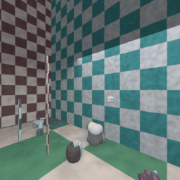
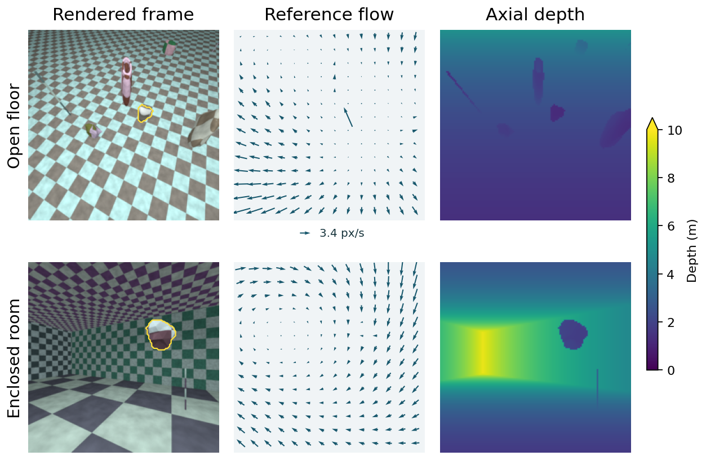

# Self-motion flow

Learn optic flow from scenes where only the observer moves. Test whether a model detects an independently moving object when camera motion and scene geometry are held fixed.



Only the camera moves in this held-out room. Nearby objects shift farther across the image than the back wall. All 31 RGB frames are shown in order at 20 frames/s, slowed from the simulated 90 frames/s.

This synthetic dataset includes camera translation and rotation in rooms and open-floor worlds. Each matched test scene shows the same target absent, stationary, or moving. A stationary target can produce a strong flow boundary from depth alone, making it a useful control for object-motion detection.



Two held-out scenes at the first interval of the moving-target condition. Yellow outlines mark the independently moving object. Arrows show renderer-derived image velocity at valid locations, with a speed key for each row. Both depth panels share a scale in meters. The first row is the downloadable matched scene.

## Try a matched scene

[Download the sample (.npz)](sample/matched_scene.npz) or clone this repository and run the example with Python and NumPy.

```sh
python -m pip install numpy
python example.py
```

The script verifies the sample, loads all three conditions, and prints target area and estimated-versus-reference flow error. The example is the first scene and first interval in the expanded test manifest.

## Full dataset

The release is packaged as one ZIP64 archive, `self-motion-flow-v1.zip` (82.30 GB, 76.65 GiB). The public download link is pending. [Check the archive SHA-256](self-motion-flow-v1.sha256). It includes all four splits, 106,400 model-grid fields with flow, depth and masks, 127,080 source RGB frames, and 106,400 corresponding physical reference records with metric depth and image displacement. Each scene also includes its geometry and camera path.

After downloading the ZIP, run the following from this repository. The preparer reads directly from the ZIP, writes only the requested arrays and checks each against the original frozen dataset's SHA-256. Preparing training and validation requires about 19.9 GB of extra disk space.

```sh
python prepare_archive.py self-motion-flow-v1.zip --out data --splits train validation
python train_heading.py --data data
```

The per-interval files under `DATA/fields/` can also be read independently. Native RGB PNGs and metric geometry are under `DATA/rendered/`. The archive README documents the coordinate conventions and array keys.

### Reproduce the geometry and coverage checks

The validation script reads the ZIP directly. It checks split membership and heading labels, independently projects source depth through the camera and target motion, and compares archived RAFT flow against geometric flow. Output CSVs identify each sampled scene and interval. The plotting script uses those tables and a matched example from the ZIP.

```sh
python -m pip install numpy scipy pillow matplotlib pandas
python validation/validate_release.py self-motion-flow-v1.zip --out results
python validation/figures.py self-motion-flow-v1.zip --results results --out figures
```

## Train a camera-heading predictor

The repository includes a small [supervised learning example](train_heading.py) that runs on CPU. Its inputs are measured flow and optionally depth. Its target is the **observer's 3D translation direction in the camera coordinate system at the start of the clip**. A heading of 0° points right, 90° forward, 180° left, and 270° backward. Positive elevation points up.

```sh
python train_heading.py
python train_heading.py --flow-only
python train_heading.py --save heading_model.npz
```

The tutorial contains one stationary-world field from each of 512 training scenes and 128 separate validation scenes. We spatially averaged the original estimated fields onto a 16 × 16 grid and converted flow to pixels/s on that grid. The readout pools the inputs onto an 8 × 8 grid, normalizes flow by its field RMS, then fits three outputs by ridge regression. Validation error is the angle between predicted and true heading, averaged within each scene and then across scenes. On the bundled subset the flow-and-depth example gives **22.53°**, flow alone gives **20.95°**, and predicting the training-set mean direction gives **95.48°**. These figures describe this linear tutorial on the bundled split.

The [NumPy loader](data.py) memory-maps the fields and looks up each label by its manifest row. It works with the bundled tutorial, the frozen full splits and the generator output.

```python
from data import HeadingDataset

train = HeadingDataset("sample/heading", "train")
field, heading = train[0]       # (3, H, W), (3,)
flow, relative_inverse_depth = field[:2], field[2]
right, up, forward = heading
```

To train on a full or generated dataset, run `python train_heading.py --data PATH_TO_DATA`. The [subset builder](make_heading_sample.py) records source indices so the tutorial can be reproduced from the full arrays.

## Generate additional scenes with Blender

The [standalone generator](generator/generate.py) uses the procedural worlds, camera paths, textures, mesh ray casting and visibility checks from the 100k dataset. Run these commands from the repository root with Blender 4.3 on your path. The first command makes a test scene in all three target conditions. The next two generate the stationary training and validation inputs for the heading example.

```sh
blender --background --factory-startup --python-exit-code 1 --python generator/generate.py -- --out generated/demo --split test --scenes 1 --frames 3
blender --background --factory-startup --python-exit-code 1 --python generator/generate.py -- --out generated/demo --split train --scenes 16 --frames 3
blender --background --factory-startup --python-exit-code 1 --python generator/generate.py -- --out generated/demo --split validation --scenes 8 --frames 3
python train_heading.py --data generated/demo
```

Each scene includes 256 × 256 RGB frames, its scene parameters, and 128 × 128 reference fields for each consecutive frame pair. The reference files store image displacement in pixels, start-frame axial depth in meters, target occupancy, endpoint validity, occlusion, frame interval and camera intrinsics for each grid. Each split also contains a loader-ready array with velocity in pixels/s and mean-one inverse depth. **Newly generated arrays use renderer ground truth. The bundled heading tutorial uses RAFT flow and estimated depth.** Use `--seed` for a new reproducible set of worlds and a fresh output location for each run. The split participates in seed derivation.

### Customize the training and test sets

Add `--moving-train` to generate two versions of each training scene with the same camera path and initial target position. The target stays stationary in one and translates independently in the other. For example:

```sh
blender --background --factory-startup --python-exit-code 1 --python generator/generate.py -- --out generated/mixed --split train --moving-train --scenes 16 --frames 6 --seed 721
```

This produces 160 fields from 16 independent scenes: 80 stationary and 80 moving. Use the manifest's `condition` column to select either group and `parent` to keep paired observations together. The published training set and the default training and validation commands contain only stationary worlds.

| Option | Effect |
| --- | --- |
| `--split` | Selects train, validation or test. Test renders absent, stationary and moving conditions for every camera path. |
| `--scenes` | Number of accepted parent scenes per split (default 4). |
| `--frames` | RGB frames per scene and condition (default 6). Each sequence yields one fewer flow interval, at 90 Hz. |
| `--seed` | Changes the reproducible set of layouts and trajectories (default 721). Each split has its own seed stream. |
| `--out` | Parent output directory. Use a fresh split destination for a new configuration. |

For experiments that require different stimulus distributions, edit [make_scene in worlds.py](generator/worlds.py). It defines room-size ranges, floor-only frequency, clutter counts and sizes, camera heading and step sizes, rotation probability, and target speed relative to camera speed. These are source-level settings shared by the generated splits. Camera step length is in metres per frame and rotation step is in radians per frame. Increasing room size changes the distribution of visible depths indirectly through the rendered geometry. Retain the modified generator with the new dataset to document its sampling design.

## Data

| Split | Flow fields | Independent parent scenes | Resolution |
| --- | ---: | ---: | ---: |
| Training | 100,000 | 20,000 | 128 × 128 |
| Validation | 1,000 | 200 | 128 × 128 |
| Original matched test | 1,800 | 120 | 64 × 64 |
| Expanded matched test | 3,600 | 40 | 128 × 128 |

Training and validation contain stationary worlds. Splits are disjoint by parent scene. In the original test there are 600 fields per target condition. In the expanded test there are 1,200 per condition. Repeated intervals and matched conditions share a parent. Use the scene as the resampling unit when estimating uncertainty.

## Sample format

The first axis follows the condition order in [metadata.json](sample/metadata.json). All depths correspond to the start of the flow interval.

| Array | Shape | Meaning |
| --- | --- | --- |
| `raw` | 3 × 3 × 128 × 128 | Estimated horizontal and vertical flow velocity in pixels/s, then estimated relative inverse axial depth. Flow uses RAFT and depth uses Depth Anything V2. |
| `reference_raw` | 3 × 3 × 128 × 128 | Renderer-derived flow velocity and relative inverse axial depth in the same units. |
| `occupancy` | 3 × 128 × 128 | Target coverage per pixel, ranging from 0 to 1. The stationary target also has an occupancy mask. |
| `valid` | 3 × 128 × 128 | Boolean renderer-derived validity for the reference flow. |

Positive horizontal flow points right and positive vertical flow points down in image coordinates. Multiply velocity by `dt_seconds` to obtain displacement across the interval. Inverse axial depth is divided by its per-field spatial mean. The arrays are supplied before training-set standardization. The original test uses a different pixel grid, so express velocities on a common grid before comparing their magnitudes across resolutions.
